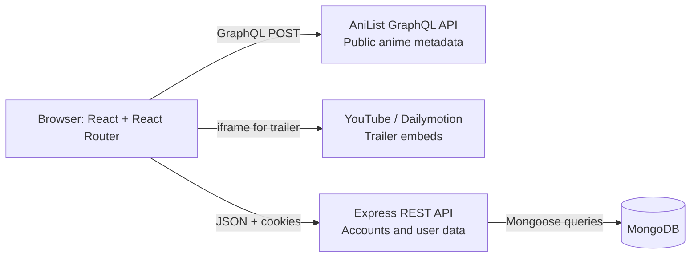

# 1. Architecture at a Glance

## The moving parts



There are two independent data paths from the browser:

1. **Public anime information** is requested from AniList by the frontend. It includes titles, images, scores, characters, studios, recommendations, and airing information. The shared implementation is [`Frontend/src/services/anilist.js`](../Frontend/src/services/anilist.js).
2. **Personal application data** goes to the project’s Express server. This includes accounts, favourites, watchlists, and comments. Express persists that data in MongoDB.

The backend does not proxy AniList. No anime catalogue is stored in MongoDB. A user's list stores numeric MAL IDs, and the frontend resolves those IDs to current AniList records when it renders the saved-list page.

## Who owns which data?

| Information | Source of truth | Stored locally? |
|---|---|---|
| Anime title, synopsis, image, score, season, characters, studio | AniList | No |
| The MAL ID used in existing detail URLs | AniList `idMal` field | It is used in routes, saved lists, and comments |
| Login identity and password hash | MongoDB `User` document | Yes |
| Favourite and watchlist membership | MongoDB `User` arrays | Yes; arrays contain MAL IDs |
| Review/comment text and owner | MongoDB `Comments` documents | Yes |
| Access and refresh tokens | Signed by Express; refresh token also stored on user | Cookies in browser; refresh token in MongoDB |

This split keeps anime records out of the app database, but it means personal lists depend on successful AniList lookups. A saved ID can remain in MongoDB even if AniList no longer resolves it.

## A complete example: opening a saved anime

Suppose the user's favourites array contains `21`.

1. `Grid` requests `GET /api/v1/favourites/list` with cookies.
2. Express authenticates the cookie and returns `[21]` in its standard response envelope.
3. `favGrid.jsx` calls `getAnimeByMalId(21)` from the shared AniList service.
4. The service sends a GraphQL request whose argument is explicitly `idMal: 21` and `type: ANIME`.
5. The returned AniList record is mapped into `CardGrid` props.
6. The card navigates to `/details/21`, preserving the site's MAL-based URL.
7. The details page repeats the lookup by MAL ID and displays the full metadata.

The IDs are deliberately distinct: AniList's internal `id` is used as a React key; the route receives `idMal`. The app does not pass a MAL ID into AniList's `id` argument.

## Runtime startup

### Frontend

[`Frontend/src/main.jsx`](../Frontend/src/main.jsx) creates the React root and wraps `<App />` with `BrowserRouter`. React Router reads the current URL and chooses a page in [`Frontend/src/App.jsx`](../Frontend/src/App.jsx).

### Backend

[`Backend/src/index.js`](../Backend/src/index.js) loads `Backend/.env`, calls `connectDB()`, then starts listening on `PORT` (or `8000` if unset). [`Backend/src/app.js`](../Backend/src/app.js) configures Express middleware and mounts routers. The process waits for the database before accepting requests.

## Request ownership

```text
React component
  ├─ anime metadata ──> AniList GraphQL
  └─ account/list/comment data ──> Express REST API ──> MongoDB
```

The React components coordinate these requests. For instance, the detail page asks AniList for the anime and independently asks Express for comments. An AniList failure should not be confused with an Express or MongoDB failure; each path has separate network requests and separate error behavior.

## Routes in the browser

| Route | Component | Meaning of `:id` |
|---|---|---|
| `/` | `HomePage` | — |
| `/details/:id` | `Details` | MAL ID; resolved with `Media(idMal: ..., type: ANIME)` |
| `/All-Characters/:id` | `AllCharacters` | MAL ID; character query also resolves through `idMal` |
| `/login` | `Login` | — |
| `/register` | `Login` | — |
| `/favourites` | `Grid` | — |
| `/watchlist` | `WatchListGrid` | — |

The implemented detail route is `/details/:id`; it is not `/anime/:id`. `BrowserRouter` gives the app client-side navigation, while Vercel's catch-all rewrite is intended to let a direct page refresh return the SPA entry document.

## Main repository boundaries

| Boundary | Location | Responsibility |
|---|---|---|
| React bootstrap and routes | `Frontend/src/main.jsx`, `Frontend/src/App.jsx` | Start the app and select pages |
| Home/detail UI | `Frontend/src/components/` | Render, collect input, and trigger requests |
| AniList integration | `Frontend/src/services/anilist.js` | Build GraphQL requests and return parsed data |
| App REST API | `Backend/src/routes/` | Define paths and attach authentication middleware |
| App business logic | `Backend/src/controllers/` | Read/modify user and comment records |
| MongoDB schemas | `Backend/src/models/` | Describe stored documents and validation |
| Authentication gate | `Backend/src/middlewares/auth.middleware.js` | Verify access token and populate `req.user` |

## Important current-state notes

- The old `docs/interview-prep` guide describes Jikan. This guide reflects the AniList code.
- `Frontend/vercel.json` still contains a rewrite for `/api/*` to Jikan's REST URL. The current frontend uses `VITE_API_URL` for the Express API and `graphql.anilist.co` for anime queries, so that Jikan rewrite appears to be legacy configuration. Confirm deployment behavior before relying on it.
- `App.jsx` creates a `cacheRef` prop, but `HomePage` currently uses the module-level `animeCache` instead. The `cacheRef` is not part of the active data path.
- There is no shared global state library. Most state belongs to the page/component that fetches it; only small module-level caches persist across route changes in the same tab.
