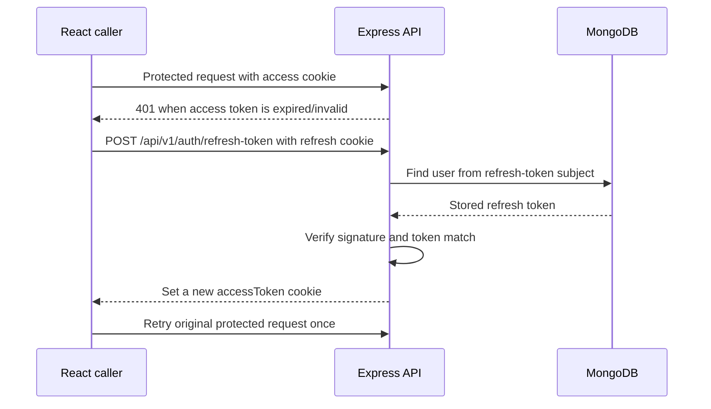

# 6. Authentication and Sessions

## The short version

The app uses email/password login, bcrypt password hashes, and two JWTs delivered as HTTP-only cookies:

- **Access token**: credential attached to protected API requests; its expiry comes from `ACCESS_TOKEN_EXPIRY`.
- **Refresh token**: credential used to issue a new access token; its expiry comes from `REFRESH_TOKEN_EXPIRY`.

The refresh token is also stored on the user's MongoDB document. The browser JavaScript does not need to read cookies; Axios sends them when a request uses `withCredentials: true`.

## Registration and password storage

The login/register page is [`Frontend/src/components/login/login.jsx`](../Frontend/src/components/login/login.jsx). It builds a `formData` object from controlled inputs and posts:

- login: `{ email, password }` to `/api/v1/auth/login`;
- registration: `{ username, email, password }` to `/api/v1/auth/register`.

The backend checks for an existing user on registration and creates a Mongoose `User`. Before saving a new/changed password, the model's `pre("save")` hook hashes it with bcrypt. Login retrieves the user by email and calls `isPasswordCorrect(password)` to compare the candidate with that stored hash.

The plaintext password should not be stored or returned. The controller selects away password and some token-related fields when preparing the user object for JSON.

## Creating a token pair

`generateAccessAndRefreshToken(userId)` in `auth.controller.js`:

1. Loads the user.
2. Calls `user.generateAccessToken()` and `user.generateRefreshToken()`.
3. Stores the refresh token on `user.refreshToken` and saves the document.
4. Returns both tokens to the caller.

The model methods sign token payloads containing user identity (`_id`, `email`, `username`) with separate environment secrets and expiry settings. The backend sends tokens as cookies configured with `httpOnly`, `secure`, and `sameSite: "none"`. The auth response also includes token strings in JSON; the frontend currently uses the cookie path rather than reading those token values.

## Login request sequence

```mermaid
sequenceDiagram
  participant User
  participant React as Login.jsx
  participant API as Express auth controller
  participant DB as MongoDB
  User->>React: Submit email + password
  React->>API: POST /api/v1/auth/login (with credentials)
  API->>DB: Find user by email
  DB-->>API: User document + password hash
  API->>API: bcrypt compare; sign access + refresh JWT
  API->>DB: Save refresh token
  API-->>React: JSON user + Set-Cookie headers
  React-->>User: Show welcome toast; navigate home
```

The registration path is similar, except it first checks duplicate username/email, creates a user, then creates tokens. In the current frontend, the registration Axios call does **not** specify `withCredentials: true`, even though the backend sends cookies. For cross-origin deployments, that can prevent the browser from storing the registration cookies. Registration currently routes the user to login afterward, which is the visible intended flow.

## How a protected request is authenticated

[`verifyJWT`](../Backend/src/middlewares/auth.middleware.js) is attached to protected routes. It:

1. Checks `req.cookies.accessToken`, then falls back to a Bearer `Authorization` header.
2. Verifies the token with `ACCESS_TOKEN_SECRET`.
3. Looks up the user by the decoded `_id`.
4. Selects away password, refresh token, and verification secrets.
5. Assigns the result to `req.user` and calls `next()`.

Controllers use `req.user._id` to scope writes to the authenticated user. This is the reason a request body does not need to include a trusted user ID.

## Refresh sequence

The refresh route does not use `verifyJWT`; its controller verifies the refresh cookie with `REFRESH_TOKEN_SECRET`, loads the user, and checks that the cookie exactly equals the refresh token stored on that user.



`HomePage` implements one refresh-and-retry for `/user/me`. The homepage `LoginBar` also attempts a refresh when its list-navigation request receives 401, and `Grid` (favourites) has its own retry logic. `WatchListGrid` itself currently has no refresh/retry handler for its initial list request, so that route can fail after an access token expires. The retry is bounded in the places where it exists so an invalid refresh token does not create an infinite request loop.

The refresh operation issues a new access token, but does not rotate the refresh token. The refresh token value remains the same until another login or logout changes it.

## Logout

`POST /api/v1/auth/logout` is protected by `verifyJWT`. The controller clears the stored refresh token and sends `clearCookie` for both names using the same cookie options. The frontend's logout action then clears its local `user` state.

Clearing the database refresh token means that an old refresh cookie can no longer mint a fresh access token. A still-valid access JWT can remain usable until it expires because logout does not maintain an access-token blacklist.

## Authentication versus authorization

- **Authentication**: is the requester a known user with a valid access token? Implemented in `verifyJWT`.
- **Authorization**: may that authenticated user perform this action on this object? For comment deletion, the controller additionally compares `comment.user` with `req.user._id`.

For favourites and watchlists, `verifyJWT` plus using `req.user._id` for the database update ensures one user cannot modify another user's arrays by changing a body field.

## Cross-origin cookies

Both client and server must opt in:

- Axios request sets `withCredentials: true`.
- Express CORS sets an explicit allowed `origin` and `credentials: true`.
- Cookie uses `SameSite=None; Secure`, so deployed sites need HTTPS.

`SameSite=None` allows cross-site cookie sending and therefore deserves CSRF consideration. CORS is not a complete CSRF defense. The current code does not show a CSRF token workflow or Origin verification for state-changing requests.

## Current session tradeoffs and learning notes

- One refresh-token field means a new login replaces the prior refresh token. Sessions are not independently tracked per device.
- The raw refresh token is stored in MongoDB rather than a hash.
- Access/refresh JWTs are returned in JSON as well as cookies; returning them in JSON is unnecessary if the client is intended to rely only on HTTP-only cookies.
- Refresh token rotation/reuse detection is not implemented.
- Cookie settings are production-oriented. `Secure` cookies normally require HTTPS, which can make plain-HTTP local development behave differently.
- The backend secret and expiry variables are `ACCESS_TOKEN_SECRET`, `ACCESS_TOKEN_EXPIRY`, `REFRESH_TOKEN_SECRET`, and `REFRESH_TOKEN_EXPIRY`; never put these in frontend `VITE_` variables.
