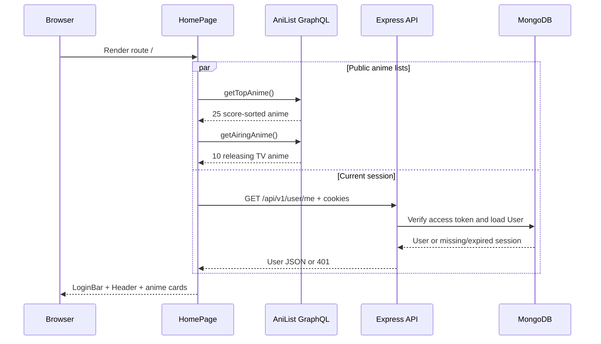
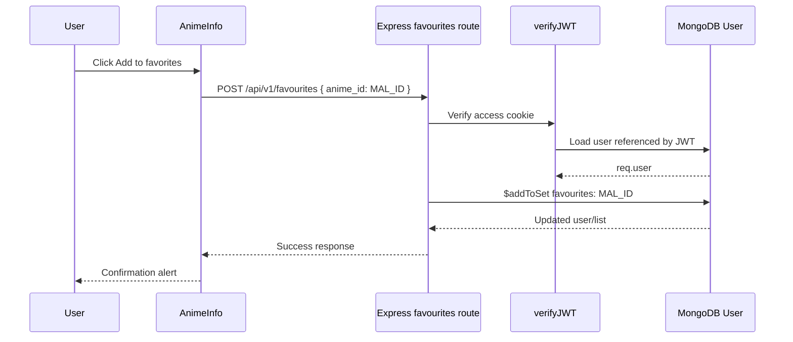

# 7. Feature and Request Flows

This chapter follows user actions through the real code. The purpose is to help answer “what runs next?” when you are debugging or adding a feature.

## Flow A: open the homepage



`HomePage` keeps the requests independent. It can show public anime even when the user is signed out. The two list responses are cached in `animeCache` for the current page lifetime.

## Flow B: search and open a title

1. The user types a title and presses Enter in `SearchBar`.
2. `searchAnime(query)` sends a GraphQL `Page.media` search to AniList. It does not filter out films by default.
3. The component takes the first search match.
4. It checks `idMal`. If present, it navigates to `/details/${idMal}`. If not, it tells the user this entry has no supported MAL route.
5. `Details` reads `id` with `useParams()` and calls `getAnimeByMalId(id)`.
6. The service queries `Media(idMal: $malId, type: ANIME)` and the detail components render the resulting record.

The key identity rule is shown in the GraphQL fields:

```graphql
query ($malId: Int!) {
  Media(idMal: $malId, type: ANIME) {
    id       # AniList's ID
    idMal    # MAL's ID
    title { english romaji }
  }
}
```

This allows bookmarked MAL URLs to keep working and avoids sending a MAL number as AniList's internal `id`.

## Flow C: save a favourite



The frontend sends only the route's MAL ID. It does not send the full AniList record. In the database, the favourite belongs to `req.user._id`, which middleware established from the signed token.

## Flow D: view favourites or watchlist

1. `Grid` calls `GET /api/v1/favourites/list` with cookies (or `WatchListGrid` calls the watchlist endpoint).
2. Express verifies the access cookie and returns an array of numeric MAL IDs.
3. The frontend checks its module cache.
4. On a cache miss, it resolves IDs to AniList records with `getAnimeByMalId` in small batches.
5. The resolved records are passed to `CardGrid`, which passes `idMal` to each `Card`.
6. A card opens `/details/:malId` or removes the item through the matching DELETE endpoint.

Batch behavior in current source:

| Page | Batch size | Delay between batches | One retry on 429 |
|---|---:|---:|---|
| Favourites | 2 titles | 1.5 seconds | 2 seconds |
| Watchlist | 3 titles | 1.1 seconds | 1.5 seconds |

This reduces bursts against the external API, but a long list can take time to populate. Failures that are not 429 are currently skipped by the list loader, so a user may see a shorter list when an AniList record cannot be fetched.

## Flow E: comments on a detail page

`Comments` is mounted under `Details`, but its data source is Express:

1. It calls `GET /api/v1/user/me` to learn the current user's ID (failure means the visitor may be signed out).
2. It calls `GET /api/v1/comments/:malId`, a public read endpoint sorted newest-first.
3. Submitting the form posts `{ animeId: Number(routeId), content }` to `/api/v1/comments/add` with cookies.
4. If the backend returns 401, the UI asks the user to log in.
5. After a successful submit, it clears the input and fetches comments again.
6. For the current user's comment, the UI renders Delete. The backend checks ownership again before deleting.

The frontend conditionally showing a Delete button is only a presentation rule. The backend ownership check is the security boundary.

## Flow F: expired access token

The home page illustrates the retry pattern:

```text
GET /api/v1/user/me with access cookie
  ├─ success -> set user in HomePage state
  └─ 401 -> POST /api/v1/auth/refresh-token with refresh cookie
       ├─ success -> retry /user/me once
       └─ failure -> keep user signed out
```

The refresh controller validates both the token signature and the refresh token saved on the MongoDB user. A retry is bounded; otherwise an expired refresh token could create a request loop.

## Flow G: open all characters

The detail query includes the first 25 character edges for the compact detail page. The “Load More Characters” button opens `/All-Characters/:malId`. The `AllCharacters` page requests page 1, then 2, etc., in `getAllAnimeCharacters` until `pageInfo.hasNextPage` is false. The route renders all returned edges as `CharacterCard` components.

Character role and voice-actor information are edge-level data. The name and portrait come from `edge.node`. This is why the mapping reads both `edge.role` and `edge.node.name`.

## Flow H: play a trailer

`getAnimeByMalId` asks AniList for `trailer { id site thumbnail }`. `Media` maps supported provider names to embeds:

- `youtube` → a YouTube privacy-enhanced embed URL;
- `dailymotion` → a Dailymotion embed URL.

There is no second title search and no dependency on a YouTube Data API key. If AniList has no trailer ID or a different unsupported site, the page displays a no-trailer message. Even with a valid embed URL, a video owner may disable embedding.

## Where to start when a feature breaks

| Symptom | First component or layer to inspect |
|---|---|
| Home cards do not load | `HomePage`, browser network request to AniList, `animeCache` |
| Search says not found | `SearchBar`, query text, AniList response, `idMal` presence |
| Detail URL loads wrong/no anime | URL MAL ID, `getAnimeByMalId`, query must use `idMal` |
| Favourite button returns 401 | Cookies, Axios `withCredentials`, CORS, `verifyJWT` |
| Saved list is missing a title | Backend ID response first, then per-ID AniList request/cache |
| Comment appears but delete is absent | Current user request and owner comparison |
| Trailer box is empty | AniList `trailer` metadata and provider's embed permission |
